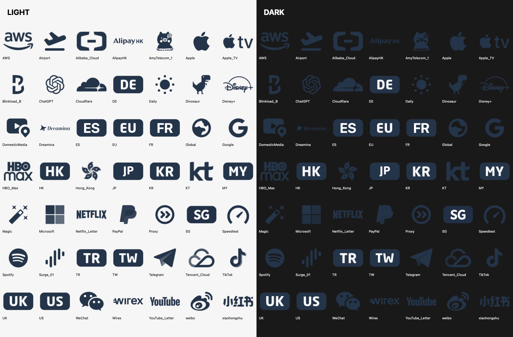

# Surge Icons

适用于 Surge 的统一深蓝色图标，共 49 个。字母图标保留深蓝底牌和白字；其他 logo 仅保留原始轮廓，深蓝色、透明背景，不添加底框或描边。SG 使用已确认的 v3 最终文件。



## 使用

在 Surge 的图标网址栏中只粘贴 PNG 网址，不要包含 `icon-url=`。

例如新加坡：

```text
https://raw.githubusercontent.com/LeiyuG/surge-icons/main/IconSet/SG.png?rev=20261103-transparent
```

编辑配置文本时才使用：

```ini
icon-url=https://raw.githubusercontent.com/LeiyuG/surge-icons/main/IconSet/SG.png?rev=20261103-transparent
```

## 图标

- `IconSet/`：49 个最终 PNG，256×256，带透明通道。字母图标为深蓝底白字；logo 为独立深蓝标识，无底框、无描边。
- `SG.png` 与已确认的 v3 文件逐字节一致；已删除带版本号的 SG 测试文件。
- 链接中的 `rev` 查询参数用于绕过旧图标缓存，不改变 PNG 文件名。
- 独立深蓝 logo 在深色界面上的对比度低于浅色界面；预览如实展示同一 PNG 在两种背景上的效果。
- ES、FR 为新增地区字母图标。
- Wirex、Dreamina、ChatGPT、AlipayHK 使用官方网站提供的标识素材。
- 其余图标保留原图标识的轮廓、字样、比例及内部明暗层次，仅统一颜色和显示大小，不添加底框。
- `icon-links.txt`：全部最终 PNG 直链。
- `group-icon-links.json`：Surge 策略组与图标链接对应关系，包含原配置中的注释项。
- `Original/`：原始图标素材；`Original/Official/` 为新增官方素材。
- `sources.json`、`original-png-links.txt`、`official-logo-sources.json`：来源记录。

## 来源与权利

原配置素材来自 [Koolson/Qure](https://github.com/Koolson/Qure)、[fmz200/wool_scripts](https://github.com/fmz200/wool_scripts) 和 [Jasonaax/Surge](https://github.com/Jasonaax/Surge)。新增标识来自 [Wirex](https://www.wirexapp.com/)、[Dreamina](https://dreamina.capcut.com/)、[ChatGPT](https://chatgpt.com/) 和 [AlipayHK](https://www.alipayhk.com/)。具体素材网址见来源记录。

各品牌名称与标识归相应权利人所有。本仓库用于个人 Surge 策略组的服务辨识，不代表任何品牌的官方图标集、合作或背书，不更改原始素材的许可。
