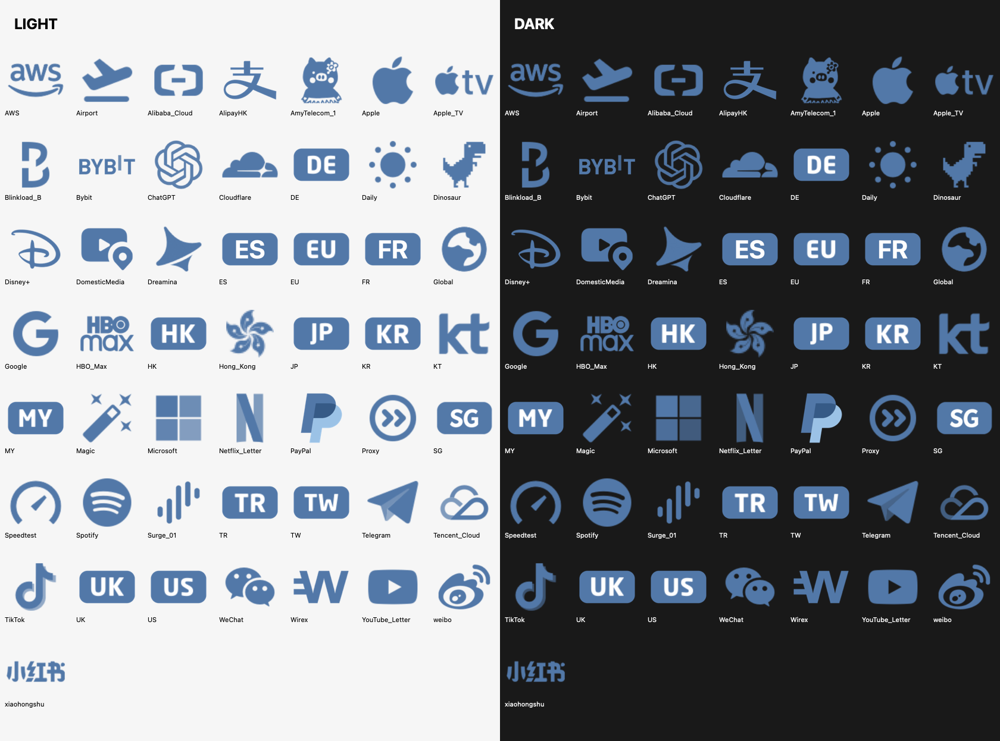

# Surge Icons

适用于 Surge 的统一配色图标，共 **50 个**。当前使用 **A 方案 · 柔和蓝 `#5278A8`**，兼顾深色与浅色界面的辨识度。

- **服务 logo**：透明背景，保留原标识轮廓与比例，以柔和蓝为主色，不添加底框或描边；PayPal 使用同色系深浅蓝区分双 P 的重叠层次。
- **地区字母图标**：底牌统一为 A 方案柔和蓝，保留白字。新加坡沿用 v3 的形状、字形与大小，仅更新底牌配色。

## 其他配色

[Baby Blue A · `#89CFF0`](BabyBlue/)：独立的全套 50 个图标、预览与链接清单，保存在 `BabyBlue/`，原版图标与原版链接保持不变。

## 深浅主题预览

同一 PNG 分别放在浅色与深色背景中展示。

## 本次更新 · 2026-11-03

- **Surge**：在与 Google、WeChat 一起缩小 5% 后，又连续单独等比例缩小两次，每次 5%。
- **Surge、Google、WeChat**：在当前尺寸基础上各等比例缩小 5%。
- **Global、FINAL**：曾各等比例缩小 5%；FINAL（`Proxy.png`）随后在缩小后的基础上放大 3%。
- **JP**：仅放大白色字母约 15%，保留底牌尺寸与原字形。
- **小红书**：保留完整字样，压缩外围留白，放大约 5%。
- **Apple TV**：保留苹果与 tv 的完整组合标识，收紧两者间距，图形等比例放大约 10%。
- **当前整体尺寸**：在上一版平衡尺寸的基础上，全部 50 个图标（含地区字母底牌）统一等比例缩小 5%，保持居中、透明背景与原有相对大小关系。

- 全套服务 logo 与地区字母底牌统一为 A 方案柔和蓝 `#5278A8`。
- **全套尺寸复查**：将 Apple、Google、Microsoft、Telegram、TikTok、Dreamina 等 20 个偏小图标等比例放大约 16%–40%，按图形轮廓平衡显示大小；Aliyun 保持此前确认的缩小尺寸。
- **AlipayHK**：去掉英文名称，仅保留官方“支”字图形并放大，无底板。
- **Dreamina**：去掉名称，仅保留原图形标识并放大。
- **Bybit**：新增独立 `Bybit.png`，使用完整官方 BYBIT 字标，移除宣传语，缩减外围留白；保留单行完整字标，不裁切、不拉伸。策略组映射已从 `Blinkload_B.png` 改为 `Bybit.png`；旧文件继续保留，兼容其他引用。
- **PayPal**：基于官方矢量重新制作，图形高度从 160 px 增至 224 px；使用柔和蓝、浅蓝与深蓝区分双 P 及重叠部分，保持透明背景。
- **Spotify、ChatGPT**：等比例放大约 38%；**Speedtest** 放大约 25%。
- **Netflix、Disney+、YouTube**：改为 N、D 与播放图形，移除完整名称并放大。为兼容已有配置，保留 `Netflix_Letter.png`、`Disney+.png`、`YouTube_Letter.png` 文件名。
- **Wirex**：移除名称，仅保留 W 图形并放大。
- **Aliyun**：整体等比例缩小约 12%，保持居中。
- 预览图直接由当前 50 个实际 PNG 生成；全部直链与策略组映射同步更新。

## 文件说明

- `IconSet/`：50 个 256×256 PNG，带透明通道。
- `Preview/`：由当前实际 PNG 生成的全套深浅背景预览。
- `icon-links.txt`：全部 50 个 PNG 直链。
- `group-icon-links.json`：Surge 策略组与图标的对应关系，包含原配置中的注释项。
- `Original/`：原始素材；`Original/Official/` 保存补充的官方素材与 AlipayHK 派生矢量。
- `sources.json`、`original-png-links.txt`、`official-logo-sources.json`：素材来源记录。

## 来源与权利

原配置素材来自 [Koolson/Qure](https://github.com/Koolson/Qure)、[fmz200/wool_scripts](https://github.com/fmz200/wool_scripts) 和 [Jasonaax/Surge](https://github.com/Jasonaax/Surge)。补充标识来自 [Wirex](https://www.wirexapp.com/)、[Dreamina](https://dreamina.capcut.com/)、[ChatGPT](https://chatgpt.com/)、[AlipayHK](https://www.alipayhk.com/) / [官方设计资源](https://docs.alipay.hk/alipayhkdocs/hk/website_hk/design)，以及 [Bybit 官方品牌资源](https://www.bybit.com/press/)。具体素材网址及处理方式见来源记录。

各品牌名称与标识归相应权利人所有。本仓库用于个人 Surge 策略组的服务辨识，不代表任何品牌的官方图标集、合作或背书，不更改原始素材的许可。
