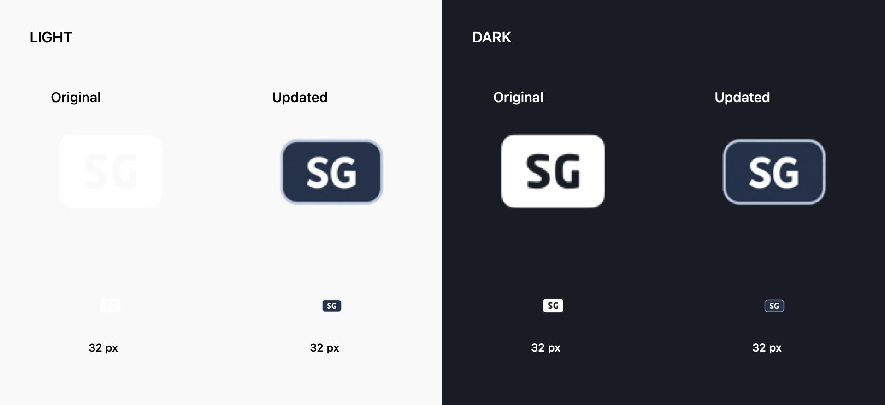

# Surge Icons

适用于 Surge 的图标收藏及深浅主题兼容版本。

## 新版图标

目前完成新加坡 SG 样图：128×128 PNG，透明外围，深蓝底牌、白色字母和浅色描边。其余图标尚未重做。

| 图标 | 预览 | PNG 直链 |
| --- | --- | --- |
| 新加坡 |  | [SG.png](https://raw.githubusercontent.com/LeiyuG/surge-icons/main/IconSet/SG.png) |

在 Surge 的新加坡策略组中，将 `icon-url` 替换为：

```ini
icon-url=https://raw.githubusercontent.com/LeiyuG/surge-icons/main/IconSet/SG.png
```

## 深浅主题对比

左侧为浅色背景，右侧为深色背景。每种背景分别展示原图与新版，下排为 32px 预览。



## 文件目录

- `IconSet/`：重新制作的深浅主题兼容图标，目前仅 SG。
- `Original/`：配置引用的 43 个去重原图，包含注释行中的引用。
- `Preview/`：效果预览。
- `icon-links.txt`：新版图标直链清单。
- `original-png-links.txt`：原始 PNG 来源链接。
- `sources.json`：原图文件与来源的对应关系。

## 来源

原图来自 [Koolson/Qure](https://github.com/Koolson/Qure)、[fmz200/wool_scripts](https://github.com/fmz200/wool_scripts) 及 [Jasonaax/Surge](https://github.com/Jasonaax/Surge)。原图权利及使用条款归各自作者，本仓库不更改其许可。新版 SG 基于原图标识重新制作。
